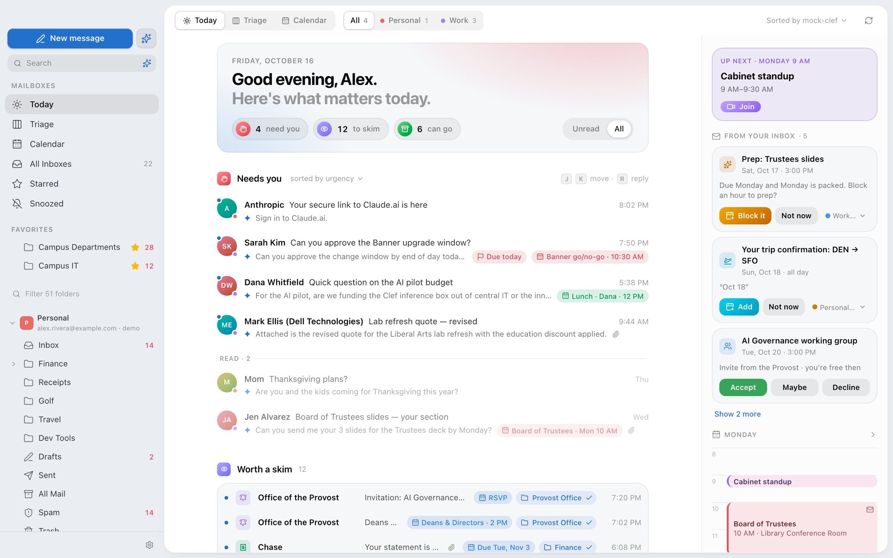
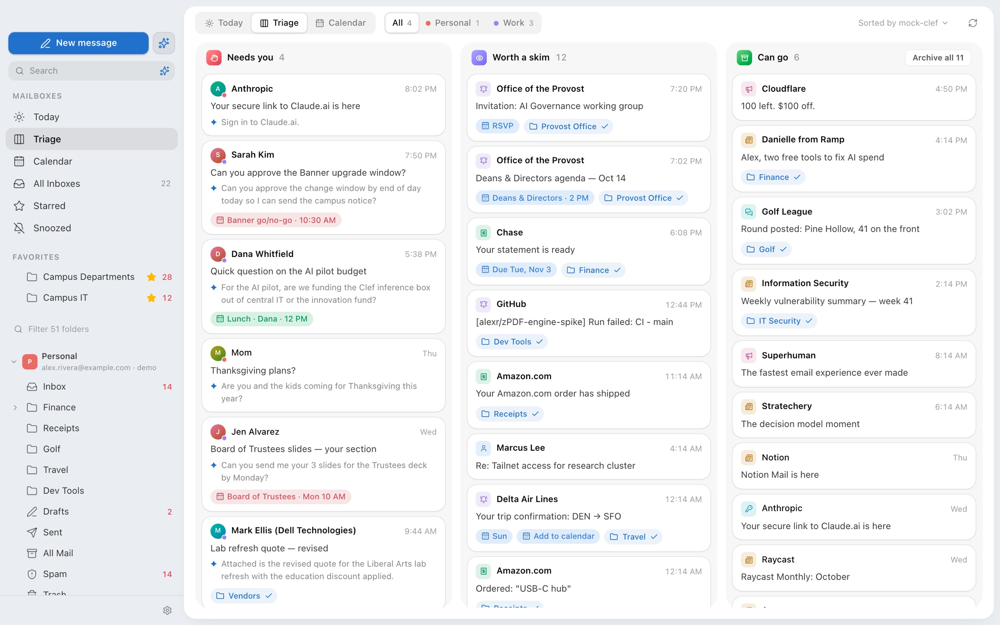
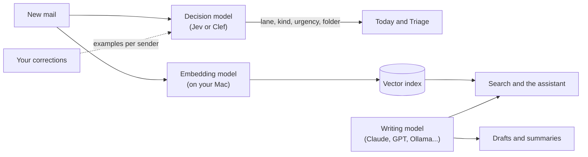

<p align="center">
  
</p>

<h1 align="center">zMail</h1>

I get a lot of email, and most of it doesn't need me. zMail is the Mac mail client I wanted for that: it sorts the inbox into what actually needs me, what's worth a skim, and what can go, and it lets me hand the busywork to an assistant.

It works with Outlook / Microsoft 365 and Gmail, and it's built with Tauri 2 (Rust), React 19, Tailwind and Zustand. macOS only. It's a personal project, so expect rough edges.

<picture>
  <source media="(prefers-color-scheme: dark)" srcset="docs/images/today-dark.jpg">
  
</picture>

<picture>
  <source media="(prefers-color-scheme: dark)" srcset="docs/images/triage-dark.jpg">
  
</picture>

<sub>Screenshots use the built-in demo mailbox.</sub>

## How it works

Most "AI email" apps send every message to a chat model and ask it what to do. That's slow, it's expensive at inbox scale, and you get back a paragraph you then have to parse. zMail splits the work across three kinds of model, each doing the one thing it's good at.



### Sorting: a decision model, not a chatbot

Sorting is a judgment call with a fixed set of possible answers, which is exactly what decision models like [Jev](https://typesafe.ai) (or the open Clef, which you can run in Ollama) are built for. Instead of a prompt asking for prose, zMail sends each email along with a handful of typed questions:

- **bucket** (choose one): needs you, worth a skim, or ready to archive
- **category** (choose one): a person writing to you, transactions, updates, promotions, social, newsletters or security
- **urgency** (a 4-step score): from "not time-sensitive" to "needs attention within the hour"
- **needs_reply** (yes or no)
- **folder** (choose one): one of your own folders, or "stay in the inbox". This is only asked when you have folders.
- **section** (choose one): one of the sections you've defined, if any

Each option comes with a plain-English description of what counts, so you can see exactly what the model was told in [`src/lib/ai/triage.ts`](src/lib/ai/triage.ts). Answers come back as probabilities, not text:

```json
"bucket": {
  "choice": "worth_skim",
  "confidence": 0.71,
  "probabilities": { "needs_you": 0.12, "worth_skim": 0.71, "ready_archive": 0.17 }
}
```

That has a few nice side effects. There's nothing to parse and nothing to go off-script, and it's quick and cheap enough to run on every message. zMail can also tell a confident answer from a coin flip. And the answers can be checked against each other: if the model calls something a promotion but also says it needs you, its own category wins and the email goes to Can go.

**It learns from you, per sender.** When you drag an email to another lane, or tell zMail it's a newsletter, it saves the sender, the subject and your choice. The next time that sender's mail is sorted, the decision model sees those as examples ("the user moved *Your statement is ready* to Worth a skim"), along with where you've filed that sender's mail before. It's told to follow your lead for similar emails but judge different ones on their own, so one bank can send statements you care about and promos you don't. zMail then re-sorts that sender's other recent inbox mail right away, so you see the effect. If you want a guarantee rather than a hint, add a rule.

### Search: an embedding model that runs on your Mac

Keyword search is great for exact names and numbers and useless for "that email about moving the budget meeting" when the email actually said "can we push Thursday's finance sync." So zMail can also search by meaning.

It's off until you turn it on in Settings → AI Assistant. Then zMail downloads [EmbeddingGemma 2](https://huggingface.co/ggml-org/embeddinggemma-2-GGUF) once (about 310 MB, pinned to an exact revision and checked against a SHA-256) and runs it locally through llama.cpp on the GPU. Your mail never leaves the Mac for this.

- **Indexing** happens in the background, newest mail first. Each email becomes one 256-number vector built from its subject, sender and its own words, with quoted replies and tracking links stripped out. Longer emails also get up to 12 passage vectors, about 300 characters each, so a single relevant paragraph can be found inside a long thread.
- **Searching** runs your query through the same model and compares it against every email vector in memory. It's a plain brute-force scan, which is fast enough at mailbox scale. Those results are merged with SQLite's full-text keyword search using reciprocal rank fusion, so exact names and numbers stay findable while paraphrases surface as Best matches above the regular results.
- **Junk stays out.** Every query has nearest neighbours, even one about nothing in your mailbox. A result found only by meaning has to clear a similarity threshold, which I tuned so related query/email pairs pass and unrelated ones don't.
- **The assistant uses the passages.** When you ask it a question about your mail, it gets the five best-matching emails with the paragraph that answers the question, instead of reading whole emails. On the test fixture that's about 1,800 characters of context instead of 15,800.

The model is unloaded after a few idle minutes, so it only uses memory while it's working. Turning it off lets you delete both the index and the model.

### Writing: a regular LLM

Drafting replies, summaries and running the assistant need a real language model, so that part goes to whichever one you connect: Claude, GPT, a local model in Ollama, or anything OpenAI-compatible. The assistant's actions show a confirm card before anything is sent, and the ones that move mail can be undone.

## What's in it

- **Today, Triage and a classic three-pane inbox.** Triage is a board: drag cards between lanes, shift-click to select a run, archive a whole lane at once.
- **The assistant** can search your mail, act on it (with Undo), draft and send replies after you confirm, read your calendar, RSVP, look people up, and change settings. Type `@` and a name to point it at someone.
- **Search by meaning**, alongside regular keyword search (see above).
- **Scheduled send, snooze, automatic replies, signatures, attachments.** Scheduled mail is sent by zMail itself, so the app has to be open. Anything overdue goes out at the next launch.
- **Calendar** with Teams, Meet and Zoom meeting creation, and drive times from Apple Maps.
- **Notifications** for new mail that needs you, with quiet hours and a dock badge.
- Dark mode that adapts the colors inside emails instead of just inverting them.

## Running it

You'll need Node with pnpm, a Rust toolchain, and Xcode's command line tools.

```sh
pnpm install
pnpm tauri dev   # the real app
pnpm dev         # UI only, in the browser at localhost:1420, with demo mail
```

Dev builds are signed with your local Apple Development identity (see `src-tauri/scripts/dev-run.sh`). Set `ZMAIL_DEV_SIGN_IDENTITY` to use a different one. Notifications only work in a signed build.

Without accounts or models connected, zMail runs on a demo mailbox and mock models, so you can poke around without setting anything up.

## Connecting accounts

Sign-in happens in your browser (OAuth with PKCE and a loopback redirect). Tokens and API keys are stored in the macOS Keychain. Mail is cached in SQLite at `~/Library/Application Support/com.zach.zmail/zmail.sqlite3`.

You bring your own OAuth app for each provider:

### Gmail, Google Calendar and Drive

1. In the [Google Cloud Console](https://console.cloud.google.com/apis/credentials), create a project and enable the Gmail, Google Calendar, Google Drive and People APIs.
2. Set up the OAuth consent screen as External and add yourself as a test user.
3. Create an OAuth client ID of type **Desktop app**, then paste the client ID and secret into Settings → Accounts → Gmail.

Scopes requested: `gmail.modify`, `gmail.settings.basic`, `calendar.events`, `calendar.calendarlist.readonly`, `drive.metadata.readonly`, `contacts.readonly`, `contacts.other.readonly`, `openid email`.

### Microsoft 365

1. In the Entra admin center, register an app with the **Mobile and desktop applications** platform and `http://localhost` as the redirect URI.
2. Under Authentication, turn on *Allow public client flows*.
3. Add these delegated permissions and grant admin consent: `Mail.ReadWrite`, `Mail.Send`, `Calendars.ReadWrite`, `Files.Read.All`, `People.Read`, `User.ReadBasic.All`, `MailboxSettings.ReadWrite`, `User.Read`, `offline_access`.
4. Paste the client ID and tenant (`organizations`, or your tenant ID) into Settings → Accounts → Microsoft 365.

If your organization blocks user consent, signing in will send an approval request to your admins instead.

### Zoom

Create a Server-to-Server OAuth app with `meeting:write:admin` and `user:read:admin`, then add the account ID, client ID, client secret and host email in Settings → Video Meetings.

### Models

Add providers in Settings → AI Providers (enter a key, connect, pick a model, send a test), then choose which model does what in Settings → AI Assistant.

| Job | Providers | API |
|---|---|---|
| Sorting | Jev, Ollama 0.35+, custom | `POST /v1/systemone` |
| Writing | Anthropic, OpenAI, Ollama, custom | Anthropic Messages or OpenAI chat completions |

Ollama limits a choice question to 26 options, so people with big folder trees get their folders narrowed down first. All model traffic goes through Rust rather than the webview, so there are no CORS problems and servers on your local network work fine.

## Finding your way around the code

- `src/lib/mail/`: the `MailProvider` interface, the Gmail and Graph implementations, and the demo mailbox.
- `src/lib/ai/triage.ts`: turns an email into one request to the decision model. The questions it asks live here.
- `src/lib/ai/decision.ts` and `generative.ts`: clients for the two kinds of model.
- `src/lib/store/`: app state (Zustand), including what zMail learns from your corrections.
- `src-tauri/src/`: the Rust side, covering HTTP, OAuth, the Keychain, SQLite, the search index and native macOS bits.

## Tests

```sh
pnpm verify        # typecheck, lint, Vitest, cargo test and clippy
pnpm test          # just the front-end tests
cd src-tauri && cargo test -- --ignored   # live checks that hit the Keychain or a real API
```
